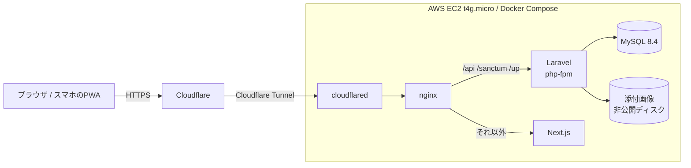

# kakeibo

Next.js（React）+ Laravel で作る家計簿アプリ。
設計・実装・テスト・インフラ構築・本番運用まで1人で行っている個人開発で、2026年9月から AWS 上で本番稼働しています。

<!--
スクリーンショットを docs/images/ に置いたら、このコメントを外して差し替える
| 収支一覧 | 収支の登録 | スマホ（ホーム画面に追加） |
|---|---|---|
|  |  |  |
-->

## 主な機能

- 収支の登録・編集・削除（カテゴリ・メモ・レシート画像の添付。大きな写真は送信前に縮小する）
- 年・月・種類・カテゴリでの絞り込みと、表示中の期間の収入・支出・収支の集計
- 世帯（家族）単位での共有。収支は世帯が所有し、メンバー全員が閲覧・編集できる（招待リンクでの参加は API まで実装済み、画面は開発中）
- プロフィール画像の登録
- スマホのホーム画面に追加して使える PWA

## 技術スタック

| 領域 | 使用技術 |
|---|---|
| フロントエンド | Next.js 16（App Router）/ React 19 / TypeScript / MUI v9 / TanStack Query / axios |
| バックエンド | Laravel 13 / PHP 8.5 / Laravel Sanctum |
| データベース | MySQL 8.4 |
| インフラ | AWS EC2（t4g.micro / arm64）/ Docker Compose / nginx / Cloudflare Tunnel / SSM Session Manager |
| 品質管理 | GitHub Actions / Featureテスト（PHPUnit）/ Larastan / ESLint / TypeScript の型検査 / Laravel Pint / Prettier |
| 開発の進め方 | Claude Code（規約は [`CLAUDE.md`](./CLAUDE.md) に集約）|

## システム構成



- フロントと API を1つのホストにまとめ、nginx がパスで振り分ける**同一オリジン構成**（CORS が不要になり、iOS の SameSite 制約も避けられる）
- セキュリティグループの**インバウンドはすべて閉じ**、外部からの到達は Cloudflare Tunnel 経由だけ。EC2 上の cloudflared コンテナが Cloudflare へ外向きに接続し、受けたリクエストを nginx に渡す。サーバへの接続は SSM Session Manager で、SSH 鍵は作らない
- 構築・リリース・脆弱性対応の手順は [`docs/deploy.md`](./docs/deploy.md) にまとめている

## 設計で決めたこと

- **層の分け方**: Controller → Service → Repository。入力の検証は FormRequest、レスポンスの整形は Resource に寄せ、Controller を薄く保つ
- **API のキーは camelCase、DB のカラムは snake_case**。変換は API の境界（Resource と FormRequest）で1回だけ行い、フロントは API が返した形をそのまま型として使う
- **認証は Sanctum の SPA クッキー認証**。トークンを JavaScript に持たせない。CSRF トークンの受け渡しは axios の `withXSRFToken` に任せる
- **URI は `/{リソース}/{操作名}`、HTTP メソッドは GET と POST の2つだけ**（例: `GET /transactions/get-list`、`POST /transactions/update`）。対象の ID も URL に入れず、FormRequest で検証する値として受け取り、検証を1か所にまとめている
- **公開リポジトリで本番の URL が分かる前提の対策**: 新規登録は設定で無効化し、ログインにはレート制限（メールアドレス×IP、IP 単位の2段階）をかけている
- **添付画像は非公開のディスクに保存**し、収支の所有（世帯）を確認してから API で返す
- **招待リンクのトークンはハッシュで保存**し、7日間で失効する

## 品質と開発の進め方

- GitHub Actions で、フロントは ESLint・型検査・整形チェック、バックエンドは整形チェック・Larastan・Featureテストを実行する。テストは SQLite ではなく**本番と同じ MySQL 8.4** で動かす
- `main`・`develop` にはブランチ保護を設定し、変更はすべてプルリクエスト経由で取り込む。コミットは1目的ずつに分ける
- Claude Code を使って開発している。規約・設計判断とその理由を [`CLAUDE.md`](./CLAUDE.md) に残し、AI が書いたコードも差分を読んで判断してから取り込む

## ディレクトリ構成

| ディレクトリ / ファイル | 内容 |
|---|---|
| `frontend/` | Next.js（App Router, TypeScript, MUI v9, TanStack Query, axios） |
| `backend/` | Laravel 13 / PHP 8.5 / MySQL 8.4。認証は Sanctum の SPAクッキー認証 |
| `docker-compose.yml` | 開発環境（frontend / backend / mysql の3コンテナ） |
| `docker-compose.prod.yml` | 本番環境（AWS EC2 + Cloudflare Tunnel）。構築・リリース手順は [`docs/deploy.md`](./docs/deploy.md) |
| `Makefile` | 開発用の定型コマンド。`make help` で一覧を表示する |

開発・実装上の規約は [`CLAUDE.md`](./CLAUDE.md) にまとめてある。

## セットアップ

事前に Docker Desktop を起動しておく。

```bash
make setup
```

`.env` の配置からコンテナの起動、アプリケーションキーの生成、マイグレーション、
カテゴリの初期データ投入までを一括で行う。

- フロントエンド: http://localhost:3000
- バックエンドAPI: http://localhost:8000
- MySQL: localhost:3306（database: `kakeibo` / user: `sail` / password: `password`）

2回目以降の起動は `make up`、停止は `make down`（DBのデータも消す場合は `make down-v`）。

## よく使うコマンド

```bash
make help
```

主なものは以下。

| コマンド | 内容 |
|---|---|
| `make up` / `make down` | 起動 / 停止 |
| `make logs` | 全コンテナのログを追う |
| `make bash-back` / `make sh-front` | 各コンテナに入る |
| `make migrate` / `make fresh` | マイグレーション / DBを作り直してシードまで |
| `make check` | CIと同じ検証をまとめて実行する |

`make` を使わない場合は `docker compose ...` を直接叩いてもよい。中身は `Makefile` を参照。

## コード整形と検証

コミット前に対象範囲を整形してから差分を確認する。

```bash
make format-front   # Prettier（フロントエンド）
make pint           # Laravel Pint（バックエンド）
```

CI（`.github/workflows/ci.yml`）は `develop` への push と `main` への
プルリクエストで走る。同じ内容をローカルで確認したい場合は次を使う。

```bash
make check
```

内訳は、フロントエンドが ESLint / `tsc --noEmit` / Prettier の確認、
バックエンドが Pint の確認 / Larastan / `artisan test`。

## Docker を使わない場合

### backend

```bash
cd backend
composer install
cp .env.example .env
php artisan key:generate
# .env の DB_HOST を 127.0.0.1 に、DB_USERNAME / DB_PASSWORD をローカルMySQLの認証情報に変更する
php artisan migrate --seed
php artisan serve
```

### frontend

```bash
cd frontend
npm install
npm run dev
```

## ブランチ運用

- `develop` がデフォルトブランチかつ日常の開発ブランチ
- `main` はリリース専用。`develop → main` のプルリクエストをGitHub上で作成してマージする
